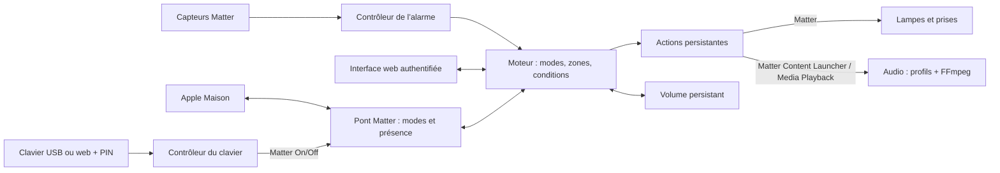

# Architecture

Le moteur Alarme, Audio et Clavier sont trois plugins indépendants. Ils peuvent partager un processus Matterbridge et son conteneur. Chaque contrôleur conserve sa propre identité Matter.

Le moteur sérialise les transitions. Les états sont Désarmé, Pré-armement, Armé, Préalarme et Alarme. Les changements reçus pendant le pré-armement ne constituent pas des événements déclencheurs. Une nouvelle souscription établit la référence d’un événement. Les états présents sont réévalués à l’armement et au réarmement.

Une transition planifie les actions dans la même écriture atomique que l’état. Les commandes communes à plusieurs associations sont dédupliquées par état et cycle. Les échecs sont conservés dans le journal ; les commandes explicites en attente peuvent être rejouées après redémarrage.

Le capteur de présence optionnel représente un déclenchement. Le parent Alarme porte la commande Désarmer et ses enfants les modes. Les identifiants d’endpoints et de contrôleurs du prototype sont conservés pour préserver les jumelages.

Les API web sont protégées par Matterbridge 3.11.2 ou ultérieur. Les droits de désarmement du clavier reposent sur la clé publique racine et l’identifiant de fabric de sa session Matter authentifiée, jamais sur son libellé.

Les capteurs Thread dépendent d’une route IPv6 via un routeur de bordure. Sous Linux, vérifier les annonces de routes /64 : une découverte mDNS réussie ne garantit pas la joignabilité du capteur. Sur l’interface LAN concernée, `accept_ra_rt_info_max_plen=64` permet de les apprendre ; ce réglage appartient à l’hôte, pas au plugin.

La simulation de présence et un compagnon Homebridge pour une présentation d’alarme native sont envisagés, mais ne font pas partie de cette version.
