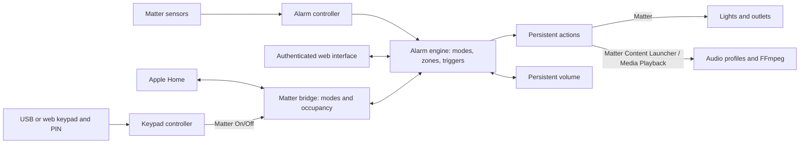

# Architecture

Alarm, Audio, and Keypad are independent plugins that can share one Matterbridge process and container. Each controller keeps its own Matter identity.

The engine serializes transitions between Disarmed, Exit delay, Armed, Entry delay, and Alarm. The exit delay ignores transitions. A new subscription establishes the baseline for transition triggers. The engine evaluates current states when arming and rearming.

Each zone holds trigger IDs. A matching trigger in a monitored zone starts an alert and records the zone and trigger. Each scenario holds an ordered list of actions. At a transition, the engine queues commands for the new state and persists them with the state in one atomic write. Disarming uses the scenarios of the mode being left. Each action runs at most once per phase and cycle. The log records failures. Pending commands may be replayed after a restart.

The optional occupancy sensor signals an alarm. The composed Alarm accessory exposes Disarm on the parent and a mode control on each child endpoint. Stable endpoint and controller IDs preserve Matter pairings.

Matterbridge 3.11.2 or newer authenticates web API requests. Keypad disarm authorization uses the authenticated Matter fabric ID and root public key.

Thread sensors need an IPv6 route through a border router. On Linux, check for the advertised /64 route on the LAN interface. The host setting `accept_ra_rt_info_max_plen=64` allows it to learn such routes.
