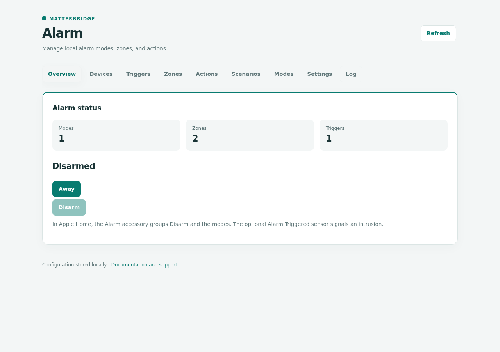

# Matterbridge Alarm

[](https://github.com/macjl/matterbridge-securitysystem-core/actions/workflows/ci.yml)

**Preview 0.11.0-alpha.3 · Apache-2.0 · Matterbridge ≥ 3.11.2 · Node.js 24 recommended**

A local alarm engine that monitors Matter sensors and sends Matter commands. The engine runs independently of Apple Home automations. Thread devices require a reachable border router.



## How it works

- Group triggers by zone and select the zones to monitor in each mode.
- Detect open/closed, motion/occupancy, and on/off as either a current state or a transition.
- Configure the exit delay, entry delay, and automatic rearming. An alarm duration of 0 keeps the alarm active until disarmed.
- Set scenarios for the exit delay, armed state, entry delay, alarm, and disarm. Disarming executes the scenarios of the mode that was active.
- Send lighting, brightness, color, or audio commands based on device capabilities.
- In Apple Home, the composed Alarm accessory offers a Disarm control and mode controls. An optional occupancy sensor signals an alarm.

The engine persists its settings, pairings, state, and deadlines. Actions run in order and are deduplicated per state and cycle. A pending command may run again after restart, so use explicit commands such as Turn on or Turn off.

A trigger such as Opens waits for a new opening. Door is open also matches an already-open door when the alarm arms. A reconnect establishes a new baseline for transitions. An entry delay continues if the sensor returns to normal.

## Configuration

1. In **Devices**, pair devices using a Matter sharing code. Identify contact sensors by serial number, Matter ID, or their live contact state. Accessories appear under their bridge, and **Rename** sets the local name for a device or accessory.
2. In **Triggers**, select the accessory and choose the state or transition to detect.
3. In **Zones**, select the triggers that belong to each zone. Triggers can be shared across zones.
4. In **Actions**, define the commands to send to devices.
5. In **Scenarios**, group actions and arrange their execution order.
6. In **Modes**, select the monitored zones, delays, and scenarios for each state.

While disarmed, use **Run** in **Scenarios** to test every action in order. The **Log** shows the outcome of each command.

In **Settings**, choose which Matter mode controls to expose. The switch group is enabled by default and supports the Keypad plugin. The lock group can be enabled alongside it. Its locked selector shows the current mode or the disarmed state. Lock a mode to activate it. Lock **Disarm** or unlock the active mode to disarm. When both groups are disabled, modes can still be controlled through the Core web interface.

Use the [Audio plugin](https://github.com/macjl/matterbridge-securitysystem-audio) for sound. An action can set **Volume (%)** on the Speaker to adjust the Master output, then send **Play a profile** to the Audio player. Configure **Stop playback** for disarming and rearming as needed. The [Keypad plugin](https://github.com/macjl/matterbridge-securitysystem-keypad) can arm and disarm through Matter, with a separate disarm permission from Apple Home.


## Local installation

```sh
git clone https://github.com/macjl/matterbridge-securitysystem-core.git
cd matterbridge-securitysystem-core
# Register the checkout with an existing Matterbridge installation.
matterbridge --add "$PWD"
```

Sign in to Matterbridge and open `/plugins/matterbridge-securitysystem-core/`. The web interface follows the browser’s preferred supported language, with English as the fallback. Matterbridge 3.11.2 or later provides authentication for the plugin API.


## Docker

```sh
docker build -t matterbridge-securitysystem-core:local .
docker compose up -d --no-build
```

The image uses Matterbridge 3.11.5 and stores configuration and pairings in `/data`. Keep that volume when replacing or rebuilding the container. HTTP defaults to port 8284 and Matter to UDP port 5545. Deployment parameters are `POC_HTTP_BIND`, `POC_HTTP_PORT`, `POC_MATTER_PORT`, `POC_MDNS_INTERFACE`, and `POC_DATA_DIR`.

To run all three plugins together, clone the repositories side by side. Run `scripts/build-stack.sh` from the Alarm repository and apply the Audio and Keypad `compose.stack.yaml` overrides. Each plugin also runs independently.


## Development and validation

```sh
npm ci
npm run check
npm test
npm pack --dry-run
```

CI checks the source, tests, and package on Node.js 24. Matterbridge supplies the Matter APIs at runtime. UI tests use simulated controllers, and network integration tests use disposable containers and storage.
